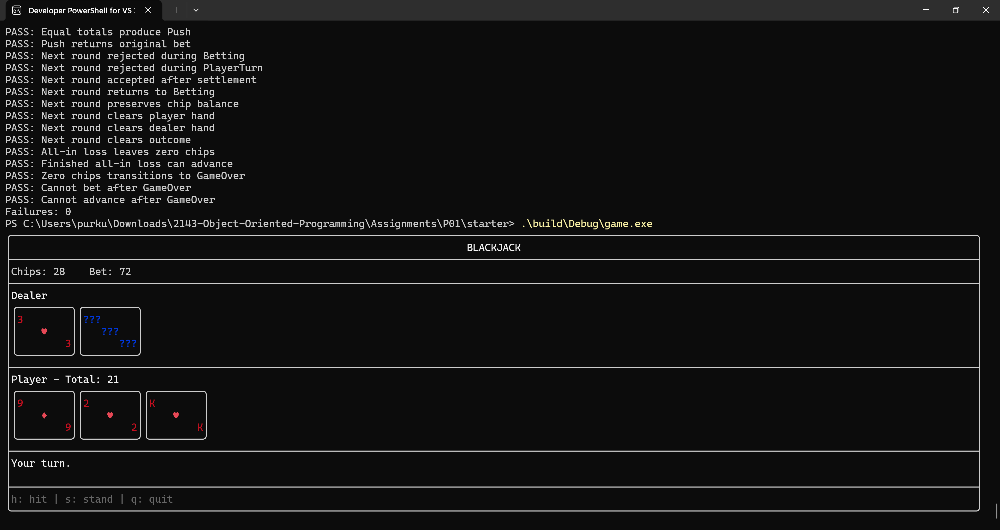

# P01 — Blackjack
Pratish Purkuti

## Overview
A terminal Blackjack game with two interfaces:
- An ASCII console interface.
- An FTXUI interface with colored cards and keyboard controls.

The player starts with 100 chips. The dealer stands on all 17s,
including soft 17. Natural blackjack pays 3:2 using integer division.

## Build — Windows / Visual Studio 2022
Run these commands from this folder:

```powershell
cmake -S . -B build -G "Visual Studio 17 2022" -A x64
cmake --build build --config Debug
```

CMake downloads and builds FTXUI during the initial configuration.
Internet access is required for that download.

## Run

```powershell
.\build\Debug\game.exe
.\build\Debug\game.exe --text
.\build\Debug\game.exe --test
```

## TUI Controls
- Up/Down: increase/decrease bet.
- Enter: deal while betting; advance after a completed round.
- h: hit.
- s: stand.
- q: quit.

## Design
- Hand contains Card objects using composition.
- Blackjack owns the deck, hands, chips, and round state.
- Blackjack contains no console input/output or FTXUI code.
- ConsoleView and TuiView inherit from GameView.
- main selects a view through std::unique_ptr<GameView>.
- Stacked decks make rule tests repeatable.

## Testing
The test runner currently reports 78 passing checks and zero failures.
It covers hand values, soft hands, naturals, payouts, invalid actions,
dealer behavior, busts, ties, and round transitions.

## Screenshot


## Changes to Starter Classes
Card and Deck were used without modifications.

## Limitations
- Split, double down, insurance, and persistent chip balances
  are not implemented.
- Small terminal windows may clip the interface. Enlarge the
  terminal or reduce its font size.
- Custom stacked test decks must contain enough cards for the round.